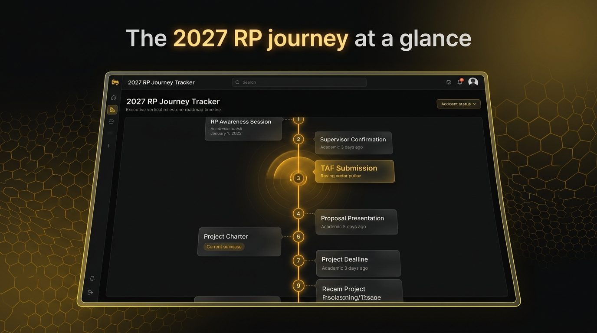

<div align="center">

# ⚡ 2027 Research Project (IT4010) Journey Tracker

**An executive, interactive milestone tracking engine and chronological roadmap designed for final-year computing research teams.**

[](https://nextjs.org/)
[](https://react.dev/)
[](https://tailwindcss.com/)
[](https://www.typescriptlang.org/)
[](https://vercel.com/)
[](https://github.com/Afnath-max/rp-journey-tracker/actions)

<p align="center">
  <i>"Start before January — the strongest teams do not wait for the semester to begin."</i>
</p>

<br />

<p align="center">
  
</p>

</div>

---

## 📌 Overview

The **RP Journey Tracker** transforms traditional academic roadmap handouts into a reactive, high-contrast, interactive web application. It guides students and researchers through the entire lifecycle of the **IT4010 Research Project** (Faculty of Computing)—from initial topic awareness and supervisor confirmation to proposal presentation viva and mid-year progress defense.

### 🌟 Key Highlights

* **🕒 Real-Time Dynamic Deadlines:** Compares today's calendar date against official university cutoff dates, auto-calculating exact remaining days (`21d Left`, `Due Today`, `Overdue`).
* **📡 Priority Radar Signal:** Autonomous pulse animation that highlights the current nearest incomplete target until marked as done.
* **🐝 Bumblebee Carbon Theme:** High-contrast obsidian dark palette (`#0f0e0c`) coupled with an organic, breathing hexagonal honeycomb canvas backdrop.
* **📋 Comprehensive Milestone Intel:** Clickable modals featuring exact deliverable checklists, evaluator expectations, and pro-tips for scoring high on panel vivas.
* **💾 Persistent Progress State:** Local state synchronization with celebration confetti upon milestone completion.
* **🛡️ Zero Hydration Collision:** Engineered with client-mount isolation and custom head sanitizers to eliminate extension-induced React 19 hydration mismatches.

---

## 🗺️ The 2027 RP Roadmap at a Glance

| # | Milestone | Target Date | Phase & Focus |
|:---:|:---|:---:|:---|
| **01** | **RP Awareness Session** | `30 Sep 2026` | Project scope, guidelines, marking schemes & team scouting |
| **02** | **Design Thinking Workshop** | `11 & 18 Oct 2026` | Problem space mapping, empathy definition & 400–2000w synthesis |
| **03** | **Supervisor Confirmation** | `20 Nov 2026` | Academic supervisor sign-off & 4-member group lock-in |
| **04** | **TAF Submission** | `10 Dec 2026` | Formal Topic Assessment Form upload (*Crucial pre-Jan target*) |
| **05** | **TAF Evaluation** | `14–16 Dec 2026` | Panel defense, research viability screening & approval |
| **06** | **Project Charter** | `04 Jan 2027` | Contractual milestone agreement, risk assessment & sprint plan |
| **07** | **Proposal Presentation** | `04–08 Mar 2027` | Formal mid-term proposal viva & architecture presentation |
| **08** | **Proposal Report** | `15 Mar 2027` | Comprehensive written report submission (IEEE format) |
| **09** | **Progress Presentation 1** | `29 Apr–03 May 2027`| 40–50% working implementation demonstration & evaluation |

---

## 🛠️ Architecture & Tech Stack

* **Framework:** [Next.js](https://nextjs.org/) (App Router, Turbopack)
* **Language:** [TypeScript](https://www.typescriptlang.org/) (Strict type-checking)
* **Styling:** [Tailwind CSS v4](https://tailwindcss.com/)
* **Animation & Interactivity:** [Framer Motion](https://www.framer.com/motion/) & [Canvas-Confetti](https://www.npmjs.com/package/canvas-confetti)
* **Icons:** [Lucide React](https://lucide.dev/)
* **Background VFX:** Custom HTML5 Canvas Honeycomb Matrix with sinusoidal breathing pulse algorithms
* **CI/CD & Security:** GitHub Actions (`ci.yml`), CodeQL Static Code Analysis & Dependabot

---

## 🚀 Getting Started Locally

### Prerequisites
* **Node.js:** `v20.x` or later (tested up to `v26.x`)
* **npm:** `v10.x` or later

### Installation

1. **Clone the repository:**
   ```bash
   git clone https://github.com/Afnath-max/rp-journey-tracker.git
   cd rp-journey-tracker
   ```

2. **Install dependencies:**
   ```bash
   npm install
   ```

3. **Start the local development server:**
   ```bash
   npm run dev
   ```

4. **Open in browser:**
   Navigate to [http://localhost:3000](http://localhost:3000)

### Production Build
```bash
npm run build
npm run start
```

---

## 📁 Repository Structure

```text
rp-journey-tracker/
├── .github/
│   └── workflows/
│       └── ci.yml             # Automated CI build & verification workflow
├── public/                    # Static assets & favicons
├── src/
│   ├── app/
│   │   ├── globals.css        # Tailwind CSS imports & theme definitions
│   │   ├── layout.tsx         # Root layout with extension sanitization & metadata
│   │   └── page.tsx           # Client-mounted home page
│   ├── components/
│   │   ├── HexagonBackground.tsx  # Dynamic HTML5 canvas breathing honeycomb matrix
│   │   ├── MilestoneCard.tsx      # Individual timeline milestone cards
│   │   ├── MilestoneModal.tsx     # Detailed deliverable & pro-tip modal dialog
│   │   └── TimelineBoard.tsx      # Central chronological vertical spine engine
│   └── data/
│       └── timelineData.ts    # Single source of truth for milestone specs & dates
├── next.config.ts             # Turbopack & Next.js compiler settings
├── package.json               # Dependencies & scripts
└── tsconfig.json              # TypeScript configuration
```

---

## 🔒 Security & Branch Governance

This repository adheres to enterprise branch protection standards:
* **Default Branch Protection:** Direct pushes and force pushes (`git push --force`) to `main` are strictly rejected by server-side rulesets.
* **Pull Request Workflow:** All changes originate on feature branches (`afn-*` / `dev`) and must pass build validation before merging.
* **Automated Code Quality:** CodeQL static application security testing (SAST) and automated secret push detection are permanently active.

---

## 📄 License

This project is open-source and intended for academic research tracking and educational guidance.
